# Poly Haven: Brick & Block textures

**40 assets from [Poly Haven](https://polyhaven.com), dedicated to the public domain under [CC0](https://polyhaven.com/license).** Use them in any game, free or paid, and change them however you like; no credit is needed.

PBR textures as 1K and 2K JPG maps (colour, normal (GL and DX), roughness, AO, displacement and more). 893.5 MB in all.

This is a copy kept by [zuujis-cc0](https://github.com/zuujis-cc0) so game makers can take single files from GitHub. It is not made by or affiliated with Poly Haven: the originals, often in more formats and higher resolutions, are on [polyhaven.com](https://polyhaven.com). If they help you, consider [supporting Poly Haven](https://www.patreon.com/polyhaven/overview).

Every file is listed in [MANIFEST.tsv](MANIFEST.tsv) with its size and SHA-256. More free assets: [the Zuujis collection](https://github.com/zuujis-cc0/free-game-assets#readme).

| | | | |
| :-: | :-: | :-: | :-: |
|  <b><a href="concrete_block_wall_03">Concrete Block Wall 03</a></b> by Charlotte Baglioni · <a href="https://polyhaven.com/a/concrete_block_wall_03">source</a> | <a href="concrete_brick_wall_001">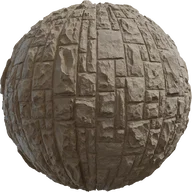</a> <b><a href="concrete_brick_wall_001">Concrete Brick Wall 001</a></b> by Dimitrios Savva, Rico Cilliers · <a href="https://polyhaven.com/a/concrete_brick_wall_001">source</a> | <a href="concrete_panels">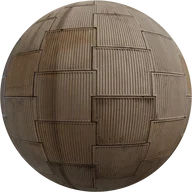</a> <b><a href="concrete_panels">Concrete Panels</a></b> by Amal Kumar · <a href="https://polyhaven.com/a/concrete_panels">source</a> | <a href="concrete_pavement">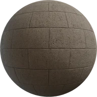</a> <b><a href="concrete_pavement">Concrete Pavement</a></b> by Charlotte Baglioni · <a href="https://polyhaven.com/a/concrete_pavement">source</a> |
| <a href="concrete_pavement_02">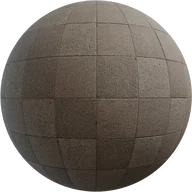</a> <b><a href="concrete_pavement_02">Concrete Pavement 02</a></b> by Charlotte Baglioni · <a href="https://polyhaven.com/a/concrete_pavement_02">source</a> | <a href="concrete_pavement_03">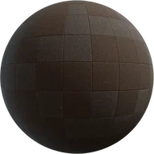</a> <b><a href="concrete_pavement_03">Concrete Pavement 03</a></b> by Charlotte Baglioni · <a href="https://polyhaven.com/a/concrete_pavement_03">source</a> |  <b><a href="concrete_pavers">Concrete Pavers</a></b> by Amal Kumar · <a href="https://polyhaven.com/a/concrete_pavers">source</a> |  <b><a href="concrete_pavers_02">Concrete Pavers 02</a></b> by Amal Kumar · <a href="https://polyhaven.com/a/concrete_pavers_02">source</a> |
| <a href="concrete_pavers_03">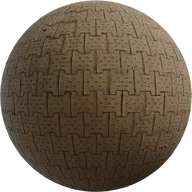</a> <b><a href="concrete_pavers_03">Concrete Pavers 03</a></b> by Charlotte Baglioni · <a href="https://polyhaven.com/a/concrete_pavers_03">source</a> |  <b><a href="concrete_tile_facade">Concrete Tile Facade</a></b> by Charlotte Baglioni · <a href="https://polyhaven.com/a/concrete_tile_facade">source</a> | <a href="concrete_tiles">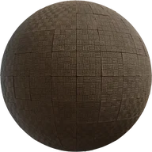</a> <b><a href="concrete_tiles">Concrete Tiles</a></b> by Dimitrios Savva · <a href="https://polyhaven.com/a/concrete_tiles">source</a> | <a href="concrete_tiles_02">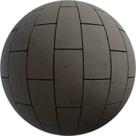</a> <b><a href="concrete_tiles_02">Concrete Tiles 02</a></b> by Charlotte Baglioni · <a href="https://polyhaven.com/a/concrete_tiles_02">source</a> |
| <a href="dark_brick_wall">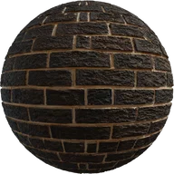</a> <b><a href="dark_brick_wall">Dark Brick Wall</a></b> by Dario Barresi, Dimitrios Savva · <a href="https://polyhaven.com/a/dark_brick_wall">source</a> | <a href="double_brick_floor">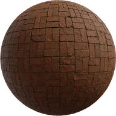</a> <b><a href="double_brick_floor">Double Brick Floor</a></b> by Dimitrios Savva · <a href="https://polyhaven.com/a/double_brick_floor">source</a> | <a href="exterior_wall_cladding">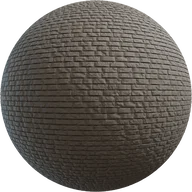</a> <b><a href="exterior_wall_cladding">Exterior Wall Cladding</a></b> by Charlotte Baglioni · <a href="https://polyhaven.com/a/exterior_wall_cladding">source</a> | <a href="exterior_wall_cladding_02">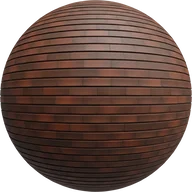</a> <b><a href="exterior_wall_cladding_02">Exterior Wall Cladding 02</a></b> by Charlotte Baglioni · <a href="https://polyhaven.com/a/exterior_wall_cladding_02">source</a> |
| <a href="factory_brick">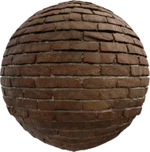</a> <b><a href="factory_brick">Factory Brick</a></b> by Rob Tuytel · <a href="https://polyhaven.com/a/factory_brick">source</a> | <a href="floor_bricks_02">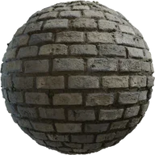</a> <b><a href="floor_bricks_02">Floor Bricks 02</a></b> by Rob Tuytel · <a href="https://polyhaven.com/a/floor_bricks_02">source</a> | <a href="floor_klinkers_01">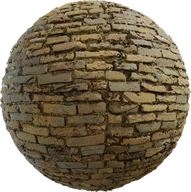</a> <b><a href="floor_klinkers_01">Floor Klinkers 01</a></b> by Rob Tuytel · <a href="https://polyhaven.com/a/floor_klinkers_01">source</a> | <a href="floor_klinkers_04">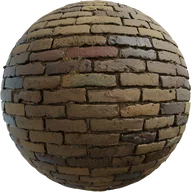</a> <b><a href="floor_klinkers_04">Floor Klinkers 04</a></b> by Rob Tuytel · <a href="https://polyhaven.com/a/floor_klinkers_04">source</a> |
|  <b><a href="floor_pavement">Floor Pavement</a></b> by Charlotte Baglioni, Dario Barresi · <a href="https://polyhaven.com/a/floor_pavement">source</a> | <a href="floor_tiles_09">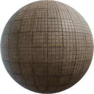</a> <b><a href="floor_tiles_09">Floor Tiles 09</a></b> by Rob Tuytel · <a href="https://polyhaven.com/a/floor_tiles_09">source</a> | <a href="grass_concrete_pavement">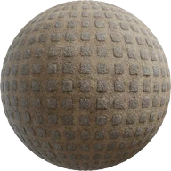</a> <b><a href="grass_concrete_pavement">Grass Concrete Pavement</a></b> by Charlotte Baglioni · <a href="https://polyhaven.com/a/grass_concrete_pavement">source</a> | <a href="grey_tiles">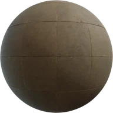</a> <b><a href="grey_tiles">Grey Tiles</a></b> by Amal Kumar · <a href="https://polyhaven.com/a/grey_tiles">source</a> |
|  <b><a href="herringbone_brick">Herringbone Brick</a></b> by Rob Tuytel · <a href="https://polyhaven.com/a/herringbone_brick">source</a> | <a href="herringbone_brick_02">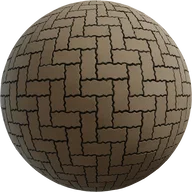</a> <b><a href="herringbone_brick_02">Herringbone Brick 02</a></b> by Charlotte Baglioni · <a href="https://polyhaven.com/a/herringbone_brick_02">source</a> | <a href="herringbone_brick_03">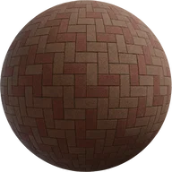</a> <b><a href="herringbone_brick_03">Herringbone Brick 03</a></b> by Charlotte Baglioni · <a href="https://polyhaven.com/a/herringbone_brick_03">source</a> | <a href="herringbone_concrete_tile">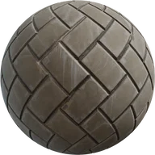</a> <b><a href="herringbone_concrete_tile">Herringbone Concrete Tile</a></b> by Charlotte Baglioni · <a href="https://polyhaven.com/a/herringbone_concrete_tile">source</a> |
| <a href="herringbone_concrete_tile_02">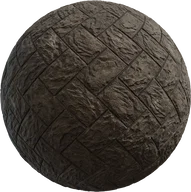</a> <b><a href="herringbone_concrete_tile_02">Herringbone Concrete Tile 02</a></b> by Charlotte Baglioni · <a href="https://polyhaven.com/a/herringbone_concrete_tile_02">source</a> | <a href="herringbone_concrete_tile_03">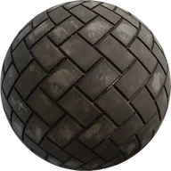</a> <b><a href="herringbone_concrete_tile_03">Herringbone Concrete Tile 03</a></b> by Charlotte Baglioni · <a href="https://polyhaven.com/a/herringbone_concrete_tile_03">source</a> | <a href="herringbone_pavement">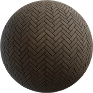</a> <b><a href="herringbone_pavement">Herringbone Pavement</a></b> by Charlotte Baglioni · <a href="https://polyhaven.com/a/herringbone_pavement">source</a> | <a href="herringbone_pavement_02">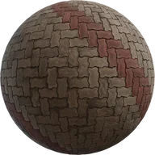</a> <b><a href="herringbone_pavement_02">Herringbone Pavement 02</a></b> by Amal Kumar · <a href="https://polyhaven.com/a/herringbone_pavement_02">source</a> |
| <a href="herringbone_pavement_03">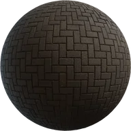</a> <b><a href="herringbone_pavement_03">Herringbone Pavement 03</a></b> by Rob Tuytel · <a href="https://polyhaven.com/a/herringbone_pavement_03">source</a> | <a href="herringbone_pavement_04">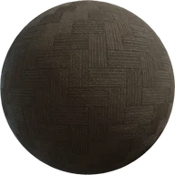</a> <b><a href="herringbone_pavement_04">Herringbone Pavement 04</a></b> by Charlotte Baglioni · <a href="https://polyhaven.com/a/herringbone_pavement_04">source</a> | <a href="hexagonal_concrete_paving">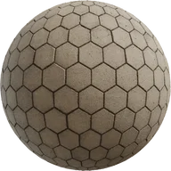</a> <b><a href="hexagonal_concrete_paving">Hexagonal Concrete Paving</a></b> by Stephan Seeliger · <a href="https://polyhaven.com/a/hexagonal_concrete_paving">source</a> |  <b><a href="interlocking_concrete_pavers">Interlocking Concrete Pavers</a></b> by Amal Kumar · <a href="https://polyhaven.com/a/interlocking_concrete_pavers">source</a> |
| <a href="japanese_stone_wall">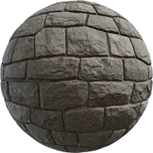</a> <b><a href="japanese_stone_wall">Japanese Stone Wall</a></b> by Charlotte Baglioni, Dario Barresi, Rico Cilliers · <a href="https://polyhaven.com/a/japanese_stone_wall">source</a> | <a href="large_floor_tiles_02">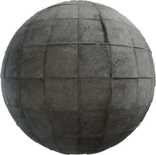</a> <b><a href="large_floor_tiles_02">Large Floor Tiles 02</a></b> by Rob Tuytel · <a href="https://polyhaven.com/a/large_floor_tiles_02">source</a> | <a href="large_red_bricks">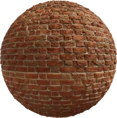</a> <b><a href="large_red_bricks">Large Red Bricks</a></b> by Rob Tuytel · <a href="https://polyhaven.com/a/large_red_bricks">source</a> | <a href="large_sandstone_blocks">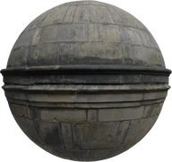</a> <b><a href="large_sandstone_blocks">Large Sandstone Blocks</a></b> by Rob Tuytel · <a href="https://polyhaven.com/a/large_sandstone_blocks">source</a> |

---

Kept up to date by this repository's own [update workflow](.github/workflows/update.yml), with code and plan from [cc0-mirror](https://github.com/zuujis-cc0/cc0-mirror). Something wrong? [Open an issue there](https://github.com/zuujis-cc0/cc0-mirror/issues/new) or use the [private report form](https://games.zuujis.com/report).
